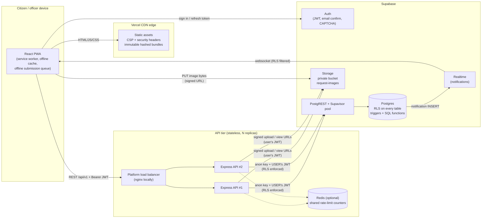

# Murang'a County Public Service Request System

A mini eCitizen-style platform where residents of Murang'a County report public
service problems (broken streetlights, water supply, garbage collection, roads,
drainage, and more) and county officers review, update and resolve them.

| | |
|---|---|
| **Frontend** | React 19 + Vite + TypeScript (strict), React Router, TanStack Query, React Hook Form + Zod, Recharts, installable PWA |
| **Backend** | Node.js 22 + Express 5 + TypeScript (strict), Zod, helmet, pino, express-rate-limit (+ optional Redis) |
| **Data / Auth** | Supabase: Postgres (RLS on every table), Auth (email confirmation + CAPTCHA), Storage (private bucket), Realtime |
| **Hosting** | Frontend on Vercel (CDN edge); API on Render/Railway/Fly.io as 2+ stateless instances behind the platform load balancer |

The repository is a monorepo with **two fully independent apps**. Neither
imports code from the other; they communicate only through the HTTP contract in
[`backend/openapi.yaml`](backend/openapi.yaml).

```
.
├── backend/          REST API + database (migrations, seed, RLS tests)  -> backend/README.md
├── frontend/         React PWA                                         -> frontend/README.md
├── nginx/            Load balancer config for the local 2-replica demo
├── docker-compose.yml
└── .github/workflows/ci.yml
```

---

## Contents

1. [Architecture](#architecture)
2. [Features](#features)
3. [Getting started](#getting-started)
4. [Manual configuration checklist](#manual-configuration-checklist)
5. [Environment variables](#environment-variables)
6. [Database: migrations, seed, first admin](#database-migrations-seed-first-admin)
7. [Running tests](#running-tests)
8. [Docker and the load-balancer demo](#docker-and-the-load-balancer-demo)
9. [Deployment](#deployment)
10. [Installing the PWA](#installing-the-pwa)
11. [Security model](#security-model)
12. [OWASP Top 10 mapping](#owasp-top-10-2021-mapping)
13. [Load test results](#load-test-results)
14. [Scalability analysis](#scalability-analysis)
15. [Limitations and future work](#limitations-and-future-work)

---

## Architecture



**Request flow (security-critical path)**

1. The browser signs in with **Supabase Auth** and receives a short-lived JWT.
2. It calls the API with `Authorization: Bearer <jwt>`.
3. The `authenticate` middleware **verifies the JWT locally** (JWKS or legacy
   HS256 secret, with pinned issuer, audience, algorithm and expiry), then
   **loads the role from `public.profiles`**. JWT `user_metadata` is
   user-editable and is never consulted.
4. Repositories create a **Supabase client per request bound to the caller's
   JWT**, so Postgres RLS evaluates every query as that user. Even a bug in
   a service cannot return another citizen's data.
5. Business rules that must never be bypassed live **in the database**:
   status transitions, `resolved_at`, status history, the 10/day quota and
   notification fan-out are all enforced by triggers.

**Layering in the API**: `routes` → `controllers` (thin: parse, validate, call,
respond) → `services` (all business logic) → `repositories` (the only place
that talks to Supabase; every row is parsed with Zod at the boundary).

---

## Features

**Required**
- Citizen registration (email confirmation + CAPTCHA) and login
- Submit a request: category, sub-county, location, description, optional photo
- Admin dashboard
- Status tracking: Pending → In progress → Resolved (enforced by the database)
- Analytics: open vs resolved

**Bonus (all implemented)**
- Citizen request history with a visual status timeline
- Status-change audit history: who, what, when, plus officer notes
- Admin filters (status, category, sub-county), full-text search and cursor pagination; filters live in the URL so views can be bookmarked
- Murang'a sub-county selection (Kiharu, Kigumo, Kangema, Mathioya, Kahuro, Murang'a South, Gatanga, Kandara, Maragua)
- Optional GPS capture (user-initiated, with a map link)
- In-app notifications on status change and officer messages via **Supabase Realtime**
- Admin notes visible to the citizen (status-change notes and public messages); internal notes stay hidden by RLS
- Analytics charts: by category, by sub-county, average resolution time, 30-day trend; every chart has a data-table view
- Dark mode (system / light / dark)
- PWA: installable, offline app shell, cached data offline, offline submission queue with idempotent replay, update prompt

---

## Getting started

Prerequisites: **Node.js 22+**, npm 10+, a Supabase project (or the Supabase
CLI + Docker for a local stack), optionally Docker for the load-balancer demo.

```bash
# 1. Database (see "Database" below for details)
cd backend
supabase link --project-ref <your-ref>     # or: supabase start (local)
supabase db push                           # apply migrations
psql "$DATABASE_URL" -f supabase/seed.sql  # reference data (local: applied by `supabase db reset`)

# 2. API
cp .env.example .env                       # fill in SUPABASE_URL / SUPABASE_ANON_KEY
npm ci
npm run dev                                # http://localhost:4000/health

# 3. Web app (new terminal)
cd ../frontend
cp .env.example .env                       # VITE_API_BASE_URL, VITE_SUPABASE_URL, VITE_SUPABASE_ANON_KEY
npm ci
npm run dev                                # http://localhost:5173
```

For local development without CAPTCHA, set `CAPTCHA_REQUIRED=false` in
`backend/.env`, leave `VITE_TURNSTILE_SITE_KEY` empty, and keep CAPTCHA
disabled in your local Supabase Auth settings.

---

## Manual configuration checklist

Things code cannot do for you. Do them once per environment.

| # | Where | What |
|---|---|---|
| 1 | Supabase → Authentication → Providers → Email | **Enable "Confirm email"**. (RLS also blocks unverified users from inserting, as defence in depth.) |
| 2 | Supabase → Authentication → URL Configuration | Site URL = your frontend URL. Add `https://<frontend>/auth/callback` (and `http://localhost:5173/auth/callback`) to **Redirect URLs**. |
| 3 | Cloudflare dashboard → Turnstile | Create a widget for your frontend domain(s). Copy the **site key** (frontend) and **secret key** (Supabase). |
| 4 | Supabase → Authentication → Attack Protection | **Enable CAPTCHA**, provider *Turnstile*, paste the secret key. Then set `CAPTCHA_REQUIRED=true` (backend) and `VITE_TURNSTILE_SITE_KEY` (frontend). |
| 5 | Supabase → Authentication → Policies (or config) | Minimum password length 10, require upper/lower/digits (matches the app's validation). |
| 6 | Supabase → Storage | Nothing to click: the `request-images` bucket (private, 5 MB, JPEG/PNG/WebP) and its policies are created by migration `0500`. Verify it is **private**. |
| 7 | Supabase → Database → Replication | Migration `0400` adds `notifications` to the `supabase_realtime` publication. Verify Realtime is enabled for the project. |
| 8 | SQL editor | **Create the first admin** (see below). |
| 9 | Render/Railway/Fly env | Set backend env vars; set `TRUST_PROXY_HOPS` to the number of proxies (Render/Railway: 1). Optionally add Redis and set `REDIS_URL`. |
| 10 | Vercel env | Set the `VITE_*` variables; update `connect-src` in `frontend/vercel.json` to your exact API and Supabase hosts (see Deployment). |
| 11 | Supabase → Project Settings → API | Make sure you **never** copy the `service_role` key into either app. Neither needs it. |

---

## Environment variables

### Backend (`backend/.env`)

| Variable | Required | Default | Purpose |
|---|---|---|---|
| `SUPABASE_URL` | yes | | Project URL |
| `SUPABASE_ANON_KEY` | yes | | Public anon key (RLS protects data) |
| `SUPABASE_JWT_SECRET` | legacy only | | Only for projects still signing JWTs with HS256; otherwise tokens are verified via JWKS |
| `CORS_ORIGINS` | yes | | Comma-separated exact frontend origins |
| `AUTH_REDIRECT_URL` | yes | | Email confirmation redirect (`https://<frontend>/auth/callback`) |
| `CAPTCHA_REQUIRED` | no | `true` | Must match Supabase CAPTCHA setting |
| `PORT` | no | `4000` | |
| `NODE_ENV` | no | `development` | |
| `LOG_LEVEL` | no | `info` | pino level |
| `TRUST_PROXY_HOPS` | no | `1` | Proxies in front of the API (correct client IPs for rate limiting) |
| `BODY_LIMIT` | no | `100kb` | JSON body limit |
| `REDIS_URL` | no | | Shared rate-limit store across instances |
| `RATE_LIMIT_GLOBAL_MAX` | no | `300` | Per-IP requests per 15 min on `/api` |
| `SUPABASE_TIMEOUT_MS` | no | `8000` | Timeout per Supabase call |
| `SIGNED_URL_TTL_SECONDS` | no | `600` | Lifetime of image view URLs |
| `SHUTDOWN_TIMEOUT_MS` | no | `15000` | Graceful shutdown deadline |

The API **refuses to start** if any required value is missing or malformed,
and reports only the variable names (never values).

### Frontend (`frontend/.env`)

| Variable | Required | Purpose |
|---|---|---|
| `VITE_API_BASE_URL` | yes | API origin, e.g. `https://api.example.org` |
| `VITE_SUPABASE_URL` | yes | For Auth + Realtime only |
| `VITE_SUPABASE_ANON_KEY` | yes | Public anon key |
| `VITE_TURNSTILE_SITE_KEY` | prod | Public Turnstile site key; empty disables the widget |

Everything prefixed `VITE_` ends up in the public bundle, so only public values
belong there. `.env` files are git-ignored; `.env.example` files are committed.

---

## Database: migrations, seed, first admin

All schema changes are SQL migrations in `backend/supabase/migrations`
(never edit the schema in the dashboard):

| Migration | Contents |
|---|---|
| `0100_foundation` | Enums, `updated_at` trigger function, custom SQLSTATE convention |
| `0200_tables` | Tables, constraints (CHECK/UNIQUE/FK with deliberate ON DELETE), indexes with growth/strategy comments |
| `0300_functions_triggers` | `is_admin()`, profile bootstrap, status state machine, history, `resolved_at`, 10/day quota, notification fan-out, RPCs (`change_request_status`, `attach_request_image`, `get_request_analytics`) |
| `0400_rls_and_grants` | RLS policies on every table, least-privilege column grants, function grants, Realtime publication |
| `0500_storage` | Private `request-images` bucket + storage policies |

```bash
cd backend
# Hosted project
supabase link --project-ref <ref>
supabase db push
psql "<connection string>" -f supabase/seed.sql        # idempotent, safe to re-run

# Local stack (Docker)
supabase start
supabase db reset        # applies migrations + seed.sql
```

### Creating the first admin

Admins cannot be created through the app (no self-promotion; the `role`
column is not even updatable by clients). Register a normal account, confirm
the email, then in the **SQL editor** (runs as a trusted server session):

```sql
update public.profiles
   set role = 'admin'
 where id = (select id from auth.users where email = 'officer@muranga.go.ke');
```

The user must sign out and in again (or reload) for the app to pick up the new role.

---

## Running tests

```bash
# Backend: unit + Supertest integration (auth, role guard, validation, rate limit, hardening)
cd backend && npm test

# Frontend: Vitest + React Testing Library (components, Zod schemas, API client, offline queue)
cd frontend && npm test

# Database: RLS + business rules against the real migrations
psql "$DATABASE_URL" -v ON_ERROR_STOP=1 -f backend/supabase/tests/rls_test.sql
```

`rls_test.sql` runs in a single transaction and rolls back. It proves that a
citizen **cannot read another citizen's request**, **cannot change status**
(direct UPDATE or RPC), **cannot self-promote**, and that an **unverified user
cannot insert**. It also checks that status transitions cannot skip steps, the
10/day quota, that internal notes stay hidden, and the storage path rules
(26 assertions). CI runs it on vanilla Postgres 17 using
`supabase/tests/supabase_stub.sql`, which emulates the Supabase `auth`/`storage`
objects.

CI (`.github/workflows/ci.yml`) runs on every push and PR: `npm ci`, **`npm
audit --omit=dev --audit-level=high`**, lint, typecheck, Prettier check,
tests and build for both apps, the database suite, and a Docker build that
asserts the image refuses to boot without configuration.

---

## Docker and the load-balancer demo

```bash
cp backend/.env.example backend/.env    # fill in Supabase values
docker compose up --build
```

This starts **two API replicas** (`api-1`, `api-2`), **nginx** on
`http://localhost:8080` doing round-robin with passive health checks, and
**Redis** so both replicas share rate-limit counters. Every response carries
`X-Upstream`, which alternates between replicas:

```bash
for i in 1 2 3 4; do curl -s -D - http://localhost:8080/health -o /dev/null | grep -i x-upstream; done
docker compose stop api-1   # traffic keeps flowing through api-2
```

The API image is multi-stage, runs as the non-root `node` user, uses `tini` as
PID 1 so `SIGTERM` reaches Node, and has a `HEALTHCHECK`. Compose runs it
read-only with all Linux capabilities dropped.

**Load balancing comes from nginx locally and the hosting platform in
production, not from application code.** The application's job is to be
stateless, so any replica can serve any request: no in-memory sessions, JWT
auth, shared state only in Postgres and (optionally) Redis.

---

## Deployment

### Database (Supabase)
Apply migrations and the seed (see above), then finish the
[manual checklist](#manual-configuration-checklist). Use the
**Supavisor transaction-mode pooler** (port 6543) for any direct Postgres
connection you add later (migrations from CI, reporting jobs). The API itself
talks to PostgREST over HTTPS, which pools internally.

### API (Render example; Railway/Fly.io are equivalent)
1. New **Web Service** → root directory `backend` → runtime **Docker** (uses `backend/Dockerfile`).
2. Health check path `/ready`. Set **instances ≥ 2** (or autoscaling with min 2).
3. Environment: the variables above (`TRUST_PROXY_HOPS=1`). Add a Render Key Value (Redis) instance and set `REDIS_URL` so rate limits are global.
4. Deploys are zero-downtime: the platform sends `SIGTERM`, the API reports not-ready, drains in-flight requests and exits.

### Frontend (Vercel)
1. Import the repo → root directory `frontend` (framework: Vite; `vercel.json` sets build/output).
2. Set the `VITE_*` environment variables.
3. **Tighten the CSP** in `frontend/vercel.json`: replace `https://*.supabase.co wss://*.supabase.co https://*.onrender.com` in `connect-src` (and `img-src`) with your exact project and API hosts.
4. Add the production URL to Supabase redirect URLs and to the API's `CORS_ORIGINS`.

`vercel.json` provides SPA rewrites, CSP, HSTS (preload), `X-Content-Type-Options`,
`X-Frame-Options`/`frame-ancestors`, `Referrer-Policy`, `Permissions-Policy`
(only geolocation for self), COOP, **immutable year-long caching for hashed
`/assets/*`** and `no-cache` for `index.html`, `sw.js` and the manifest so
updates propagate.

---

## Installing the PWA

- **Android / Chrome / Edge**: open the site, then use *Install app* in the menu (or the address-bar install icon).
- **iOS Safari**: Share → *Add to Home Screen*.

Offline behaviour: the app shell is precached; previously viewed API data is
served from a NetworkFirst cache; new requests submitted offline are stored
locally and **sent automatically on reconnect** with their original
idempotency key, so they are never duplicated. Photos need a connection and
can be added afterwards from the request page. When a new version is deployed
the app shows an *Update now* banner instead of reloading mid-task. Signing
out deletes cached API responses from the device.

---

## Security model

**Route guards in React are UX only.** They decide what to render. The real
authorisation is the backend middleware (JWT verification + role from
`profiles`) **plus Postgres RLS**. A user who edits the JavaScript, or calls
the API directly, still gets `401`/`403`/`404` and can only ever touch rows RLS
allows for their own JWT.

Defence in depth, layer by layer:

| Layer | Controls |
|---|---|
| Browser | CSP (no inline script/style, no `eval`), no `dangerouslySetInnerHTML` (lint-enforced), React escaping, Zod validation (UX only), no secrets in bundle |
| Edge | HSTS preload, frame denial, strict referrer policy, permissions policy |
| API | helmet, strict CORS allowlist (no credentials mode), 100 KB body limit, rate limits (global per IP; stricter on register, create, upload, comments; Redis-backed when configured), Zod validation + text sanitisation, JWT verification with pinned issuer/audience/alg, role from DB, centralised error handler (no stack traces, request IDs), structured logs with credential redaction |
| Database | RLS on every table, column-level grants (clients cannot write `status`, `role`, `citizen_id`, `reference_number`...), CHECK/FK/UNIQUE constraints, state-machine triggers, quota trigger with advisory lock, audit history, `SECURITY DEFINER` functions with `search_path = ''` and internal permission checks |
| Storage | Private bucket, 5 MB + MIME allowlist enforced by Storage, uploads only to `{uid}/{request}/{random}.{ext}` **pre-registered on the caller's own pending request**, no update/delete, short-lived signed view URLs |

**No `service_role` key anywhere.** The spec allowed it for narrow tasks; the
implementation goes further and **removes the need entirely**. Notification
fan-out runs in a `SECURITY DEFINER` trigger. Signed upload/view URLs are
created with the caller's own JWT under storage RLS. Image registration is a
narrowly scoped `SECURITY DEFINER` RPC. A full compromise of the API server
therefore yields no credential that bypasses RLS.

Every `SECURITY DEFINER` function (`is_admin`, `is_email_verified`,
`handle_new_user`, `service_requests_after_write`,
`request_comments_after_insert`, `attach_request_image`) pins
`search_path = ''`, fully qualifies identifiers, uses no dynamic SQL,
validates the caller internally where applicable, and carries a comment
explaining why definer rights are needed.

---

## OWASP Top 10 (2021) mapping

| OWASP risk | Mitigations in this project |
|---|---|
| **A01 Broken Access Control** | RLS on every table with per-role policies; role loaded from `profiles` (never JWT metadata); column grants block self-promotion and status tampering; admin routes double-guarded (`requireRole` + service check + RLS); foreign rows return 404 (no existence oracle); storage path rules; open-redirect-safe `next` parameter; RLS test suite in CI |
| **A02 Cryptographic Failures** | TLS everywhere (HSTS preload); passwords handled by Supabase Auth (bcrypt); JWTs verified with JWKS/pinned algorithms; private bucket + expiring signed URLs; no secrets in the frontend bundle or logs |
| **A03 Injection** | No SQL string building: PostgREST parameterises every filter; search uses `websearch_to_tsquery`; pagination cursors are validated and quoted; SQL functions use no dynamic SQL; Zod on every input; HTML/control/bidi chars stripped server-side; React escaping; strict CSP |
| **A04 Insecure Design** | Business rules enforced in the DB (state machine, quota, audit trail); idempotency keys for retries; threat-driven design (no service key, pre-registered upload paths); least privilege by default |
| **A05 Security Misconfiguration** | Env validated at boot (refuses to start); helmet defaults + JSON-API CSP; CORS allowlist; `x-powered-by` off; non-root read-only container; explicit `REVOKE` of Supabase default grants; default function EXECUTE revoked |
| **A06 Vulnerable & Outdated Components** | `npm audit --omit=dev --audit-level=high` in CI for both apps (currently 0 vulnerabilities including dev deps); lockfiles; `npm ci --ignore-scripts` in Docker |
| **A07 Identification & Authentication Failures** | Supabase Auth with email confirmation, CAPTCHA on signup/login, password policy (10+ chars, mixed case, digit), refresh-token rotation, rate-limited registration, generic messages (no enumeration), short JWT lifetime |
| **A08 Software & Data Integrity Failures** | Lockfile-pinned dependencies; immutable hashed assets; SW update requires user consent; audit history written only by triggers (no client insert grant) |
| **A09 Security Logging & Monitoring Failures** | Structured JSON logs (pino) with request IDs propagated from the LB; 4xx logged as warn, 5xx as error with cause; credential redaction; status-change history (who/what/when) in the DB |
| **A10 Server-Side Request Forgery** | The API never fetches user-supplied URLs; outbound calls go only to the configured Supabase URL with timeouts |

---

## Load test results

Script: `backend/tests/load/autocannon.ts` (`npm run test:load`), plus an
optional staged k6 scenario in `backend/tests/load/k6-ramp.js`.

**Measured** (single API process, development laptop: WSL2, 12 vCPU, 8 GB;
100 connections, 20 s):

| Scenario | Throughput | p50 | p97.5 | p99 | Errors |
|---|---|---|---|---|---|
| `GET /health` (framework + middleware overhead) | **~2,500 req/s** | 37 ms | 53 ms | 57 ms | 0 |

What this tells you: the Node/Express layer (helmet, CORS, request IDs,
logging, compression) is not the bottleneck. One small instance handles
thousands of requests per second of overhead. Real endpoints are bound by
Supabase round trips (typically 10-40 ms each from the same region).

**Not measured here**: the DB-bound scenarios need a real Supabase project,
which this environment did not have. Run them against staging:

```bash
docker compose up --build          # or point TARGET_URL at staging
RATE_LIMIT_GLOBAL_MAX=1000000 ...  # raise the per-IP limit on the target first:
                                   # a load generator is a single IP
TARGET_URL=http://localhost:8080 TOKEN=<citizen access token> DURATION=30 CONNECTIONS=50 npm run test:load
```

The script exits non-zero if any request fails or p99 exceeds `P99_BUDGET_MS`
(default 800 ms), so it can gate a release.

---

## Scalability analysis

Assumptions: about 5% of registered users are active on a given day; an
active citizen makes about 10 API calls per session; reporting peaks at
about 5× the daily average (Monday mornings, after storms). Every API
request costs 1 JWT verification (local CPU) plus 1-3 PostgREST round trips.

| Users | Peak load (rough) | Bottleneck you hit first | What to change |
|---|---|---|---|
| **100** | < 1 req/s | Nothing. Cost is the only concern. | Supabase Free, 1 small API instance (2 for zero-downtime deploys), Vercel Hobby. ≈ $0-7/month. |
| **1,000** | ~1-2 req/s | Supabase Free limits (pausing after inactivity, 500 MB DB, 1 GB storage, 2 GB egress) | Supabase Pro ($25/mo: 8 GB DB, 100 GB storage, daily backups, no pausing). 2 API instances. Turn on Redis-backed rate limits. ≈ $40-60/month. |
| **10,000** | ~10-20 req/s; ~100-500 requests/day | **Storage + egress** from photos (≈ 1-2 MB each → ~15-30 GB/month); per-IP rate limits from carrier-grade NAT on Safaricom/Airtel | Client-side image downscaling before upload (e.g. 1600 px WebP, ≈ 200 KB); serve thumbnails via Supabase image transformations; per-user keying is already used on write routes, so consider raising the global per-IP budget. Add uptime and error alerting. ≈ $60-120/month. |
| **100,000** | ~100-200 req/s at peak | **Postgres**: connection/PostgREST capacity on small compute; analytics aggregation over 100k+ rows on every dashboard load; Realtime concurrent connections (Pro includes 500) | Upgrade Supabase compute (Small/Medium); move analytics to a **materialized view refreshed by `pg_cron`** every few minutes (the function's output shape stays the same); cache `/me` role lookups for ~30 s in Redis; autoscale API 2-6 instances on CPU; Realtime: subscribe only while the app is visible, or poll unread counts. Partition-free still fine (< 5M rows). ≈ $300-800/month. |
| **1,000,000** | ~1,000-2,000 req/s at peak; county-wide adoption | **Single-primary Postgres write/read capacity**, Realtime fan-out, egress costs, operational load (support, moderation, abuse) | Read replicas for admin lists/analytics; consider moving JWT→profile lookups to custom JWT claims (Supabase Auth hook) so most requests need **one** DB round trip; partition `notifications` (and `service_requests` by year) with retention jobs; CDN-cache public reference data at the edge; queue (e.g. pg-boss/SQS) for SMS/email notifications; WAF/bot protection at the edge; dedicated on-call. Note Murang'a has ~1.06M residents, so this is the realistic ceiling. ≈ $2k-6k/month. |

Dimension by dimension:
- **CPU (API)**: JWT verification is local (no Auth round trip) and per-request work is small. CPU scales linearly with replicas; stateless design means just adding instances.
- **Memory (API)**: measured ~105 MB RSS idle and ~200 MB under sustained load (production mode, before GC settles). Caches are bounded (reference data only). Use 512 MB instances; scale out, not up.
- **Database**: the composite indexes match every list query's `ORDER BY`, so pages are index range scans regardless of table size (cursor pagination never `OFFSET`s). The quota trigger reads one index range. The first real DB pressure is aggregation (analytics), which has a planned materialized-view path.
- **Storage**: the largest cost driver by far. Images never pass through the API (direct signed uploads), so API bandwidth stays tiny.
- **Network**: compressed JSON responses of 1-5 KB; reference data cached with ETag (304s); hashed assets cached for a year at the edge; the PWA precache means repeat visits download almost nothing.
- **Cost**: dominated by Supabase tier and egress, not compute. The API tier is cheap because it holds no state.

---

## Limitations and future work

- **Visual/Lighthouse verification**: automated tests cover components and flows, but a Lighthouse run (PWA/Accessibility target 90+) was not executed in the build environment. Run `npx lighthouse <url> --view` against the deployed site and keep the report.
- **Image content is not inspected**: Storage enforces size and declared MIME type, but not magic bytes or EXIF. Future: an Edge Function or worker that verifies the file signature and **strips EXIF GPS metadata** before the image is shown to officers.
- **Orphaned uploads**: if a citizen registers an upload path but never uploads, a stale path remains (replaceable by a later upload). Add a nightly cleanup job.
- **Offline photos**: the offline queue stores text only. Future: store blobs in IndexedDB.
- **Notifications**: in-app only. Future: SMS (Africa's Talking) and email via a queue, with per-user preferences.
- **Account deletion / data-protection requests** (Kenya Data Protection Act 2019): requests reference profiles with `ON DELETE RESTRICT` to protect the public record; implement an anonymisation procedure for erasure requests.
- **Admin management UI**: promoting officers is a SQL operation by design. A super-admin UI with an audit log would be the next step.
- **Analytics materialized view** is documented (see Scalability) but not enabled, since live aggregation is fast at current volumes.
- **Swahili localisation** of the UI.
